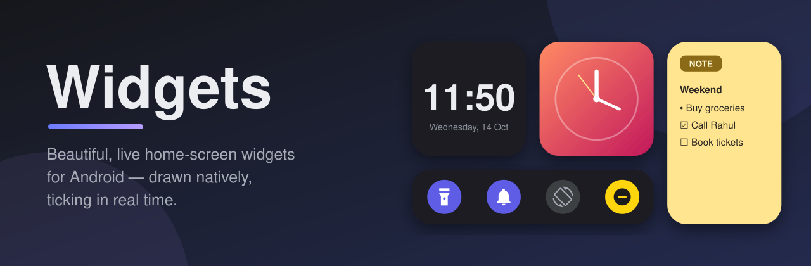
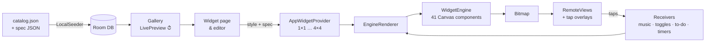

<p align="center">
  
</p>

<p align="center">
  
  
  
  
  
</p>

<p align="center">
  <b>Clocks that actually tick. Toggles that actually toggle. To-dos you tick right on your home screen.</b><br>
  114 hand-tuned designs, drawn by a native JSON-driven widget engine — and every one of them is yours to restyle.
</p>

---

## ✨ Highlights

| | |
|---|---|
| 🕰️ **Live everywhere** | Second hands sweep, flip clocks flip, visualizer bars dance — on the home screen *and* inside the app's gallery. |
| 🎛️ **Real quick toggles** | Torch, Sound (Ring → Vibrate → Silent), Do Not Disturb, Auto-rotate and Auto-brightness switch **instantly**. Need a one-time permission? A friendly in-app sheet takes you to the exact switch, then flips the toggle for you. |
| ✅ **Tappable To-Do** | Tick tasks off straight from the widget. The editor adds drag-to-reorder, swipe-to-delete with Undo and a Completed section. |
| 📝 **Sticky Notes** | Autosaving notes in 8 paper colours, three text sizes, `- ` bullets and `[ ]` checkboxes. |
| 🎵 **Music that responds** | Play/pause/skip, a live progress bar and **tap-to-seek**; vinyl, album-colour, disc and pill players. |
| 🎨 **Make it yours** | Colours, fonts, backgrounds, *Wallpaper* & *Material You* palettes, photo slideshows, saved looks — and draggable, pinch-to-scale, rotatable **stickers**. |
| 📡 **Live data** | Weather with your real location, now playing, battery & charging, earbuds/watch battery, next alarm, calendar agenda, screen time, RAM & storage. |
| 🧩 **Every size** | `1×1` · `2×1` · `2×2` · `4×1` · `4×2` · `4×4` |

## 🖼️ The catalog

114 widgets across 10 tidy categories — similar designs sit together, and the gallery packs them with no empty gaps.

| Category | # | What's inside |
|---|---:|---|
| 🕰️ **Clock** | 44 | Bubble, Holo, Candy, Serif, Pixel, LED, Bauhaus, Bezel, stacked & flip clocks, word clock, classic/pilot/sport/sunburst dials, world clocks, a 4×4 dashboard |
| 📅 **Calendar** | 10 | Date tiles, next event, week strip, month & year progress, month grid, agenda |
| 🌦️ **Weather** | 8 | Weather cards, forecast shapes, moon phase, sunrise & sunset |
| 🎵 **Music** | 8 | Vinyl, album colour, disc, cover and pill players |
| ✅ **Productivity** | 12 | To-Do (2×2 / 4×2 / 4×4), notes & sticky notes, Pomodoro, stopwatch, countdowns, habits, quotes |
| 🎛️ **Controls** | 4 | Quick Modes, Control Center, Quick Toggles, a 1×1 torch |
| 🔋 **Device** | 18 | Battery cells, glow, dot grid and fill cards, earbuds/watch battery, RAM, storage, screen time |
| ❤️ **Health** | 4 | Activity rings, steps, water, BMI |
| 🖼️ **Photos** | 2 | Photo clock, Memories slideshow |
| 🧰 **Tools** | 4 | AI search & assistant, QR, crypto ticker |

## ⚙️ How it works

Every widget is a small **JSON spec**. One engine draws it with `Canvas` — the gallery preview, the customize screen and the placed home-screen widget all use the *same* renderer, so what you see is exactly what you get.



A spec is just a background plus positioned components (frames are fractions of the widget, so it scales to any size):

```json
{
  "id": "min_todo",
  "name": "To-Do",
  "designSize": "2x2",
  "background": { "fill": "#1A1C20", "cornerRadius": 0.16 },
  "components": [
    {
      "type": "todo",
      "frame": { "x": 0, "y": 0, "w": 1, "h": 1 },
      "props": { "title": "TO-DO", "accentColor": "#6C7BFF", "listRows": 5 }
    }
  ],
  "action": { "type": "edit_todo" }
}
```

**Interactivity without a list view:** the widget is one bitmap, so taps are routed through transparent overlay layouts — a row of cells for music controls and an 8-zone seek bar, a 2×4 grid for toggles, and a 20-strip overlay that lines up exactly with To-Do rows (the renderer lays rows out on the same strips).

## 🚀 Getting started

**Requirements:** a recent Android Studio (the project uses AGP 9.3 alpha), JDK 21 (Android Studio's bundled JBR works), and a device or emulator on Android 7.0+.

```bash
git clone https://github.com/UtkarshCodecom/Widgets.git
cd Widgets
./gradlew assembleDebug
adb install -r app/build/outputs/apk/debug/app-debug.apk
```

> 💡 If `java` isn't on your `PATH`, point Gradle at Android Studio's JDK, e.g.
> `JAVA_HOME="/Applications/Android Studio.app/Contents/jbr/Contents/Home" ./gradlew assembleDebug`

Open the app, pick a widget, customize it and tap **Add to Home**.

**Firebase:** the app talks to Firestore/Auth/Storage/Remote Config. To use your own project, replace `app/google-services.json`; the expected collections are documented in [`FIREBASE_SCHEMA.md`](FIREBASE_SCHEMA.md). The built-in catalog works fully offline.

## 🧩 Add your own widget

1. **Write a spec** in `app/src/main/assets/seed/native/my_widget.json` using any of the 41 component types (`clock`, `analog_clock`, `styled_clock`, `weather`, `music`, `todo`, `toggle`, `battery`, `calendar`, `text`, `shape`, `image`, …).
2. **Register it** in `app/src/main/assets/seed/native/catalog.json` — the position inside its category is the order users see.
3. **Bump `SEED_VERSION`** in `LocalSeeder.java` so existing installs pick it up (favourites are preserved).

Need a brand-new component? Implement `ComponentRenderer` in `engine/components/` and add one `.register(...)` line in `ComponentRegistry`.

## 🗂️ Project structure

```
app/src/main/java/com/desire/widget/
├── engine/            # the widget engine
│   ├── WidgetEngine.java, ComponentRegistry.java
│   ├── components/    # 41 Canvas renderers (clocks, weather, music, todo, toggles…)
│   ├── runtime/       # EngineRenderer (RemoteViews + tap overlays), StyleApplier, stores
│   ├── data/          # live data: weather, now playing, toggles, screen time, user notes/todos
│   └── model/, util/  # spec model, fonts, colours, shapes
├── ui/
│   ├── widgets/       # gallery: grouped sections, gap-free packing, LivePreview
│   ├── customize/     # widget page, editor, stickers, saved looks
│   ├── notes/         # To-Do, Notes, Habit, BMI, QR editors
│   ├── permission/    # one-time permission sheets
│   └── settings/, onboarding/, admin/
├── widget/            # AppWidgetProviders (1×1…4×4), minute/second tickers, tap routing
├── service/           # receivers: media control, toggles, to-do, timers, calendar
├── data/              # Room DB, repository, LocalSeeder (catalog → DB)
└── worker/            # WeatherWorker (WorkManager)
```

## 🔐 Permissions — all optional

Every permission is asked only when a widget that needs it is used, and only for that feature.

| Permission | Used for |
|---|---|
| Approximate location | Weather for your city |
| Notification access | Now-playing music widgets |
| Calendar | Agenda & next-event widgets |
| Usage access | Screen-time widgets |
| Modify system settings | Auto-rotate & auto-brightness toggles |
| Do Not Disturb access | DND & Silent toggles |
| Nearby devices | Earbuds/watch battery, Bluetooth toggle |

The torch toggle needs no permission at all. See [`PRIVACY.md`](PRIVACY.md) for details — your notes and tasks are stored only on your device.

## 🛠️ Debug tools

Debug builds include a QA receiver that never touches the device screen:

```bash
# Render every catalog widget into contact sheets (app cache: render_dump/sheet_N.png)
adb shell am broadcast -a com.desire.widget.debug.RENDER_DUMP -n com.desire.widget/.debug.RenderDumpReceiver

# Capture only this app's own window (no status bar, no other apps)
adb shell am broadcast -a com.desire.widget.debug.CAPTURE_SELF --es label gallery -n com.desire.widget/.debug.RenderDumpReceiver
```

## 🗺️ Roadmap

- [ ] World-clock city search
- [ ] `2×3` / `2×4` / `3×1` sizes
- [ ] Global corner-roundness setting
- [ ] More sticker packs

---

<p align="center">Made with ☕ and a lot of <code>Canvas.drawRoundRect()</code>.</p>
